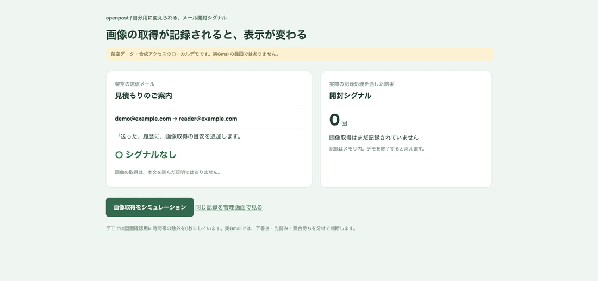

# openpost — Gmailの開封シグナルを、自分用の表示にする実験コード

最初はGoogle認証もメール送信もせず、架空データで画面を試せます。
実Gmail用のApps Scriptアドオン、Chrome拡張、追跡サーバーも含めています。



## まずローカルで試す

Node.js 22以上とnpmを準備し、このリポジトリを取得します。

```bash
git clone https://github.com/KokiFukushima-Automation/openpost-gmail-demo.git
cd openpost-gmail-demo
npm ci
npm run build
node scripts/article-demo.mjs
```

Chromeで **http://127.0.0.1:18901/demo** を開き、「画像取得をシミュレーション」を押してください。
実際の記録処理を通り、デモ画面の開封シグナルが0から1へ変わります。「同じ記録を管理画面で見る」から、管理画面でも確認できます。
これはローカルの架空データ・合成アクセスです。外部へメールは送信しません。
停止はターミナルでCtrl+C。DBはメモリ内にあり、停止すると消えます。

多数の架空データや作成画面を試す場合は `npm run demo` → http://127.0.0.1:18878/dashboard/messages 。
使用中のポートがある場合は該当デモを終了するか、スクリプトのportを変更してください。

## 自分の仕事に合わせる入口

| 変えるもの | ファイル/設定 |
|---|---|
| Gmailの記号・説明 | `extension/matcher.js` |
| 開封と先読みの分類 | `src/core/classify.ts` |
| 送信直後の除外秒数 | `.env.example` の `OPEN_IGNORE_SECONDS` |
| Google先読みの時間帯 | `.env.example` の `PROXY_PREFETCH_SECONDS` |
| 保存する情報の粒度 | `.env.example` の `PRIVACY_MODE` |

デモの時間帯除外は0秒で、画面変化を試すための設定です。実Gmailの標準設定は送信直後10秒・Google先読み60秒。
数字を小さくすると自動取得を数える可能性が上がります。精度が保証される設定ではありません。
設定の読み取りは `src/config/env.ts`、記録・表示のテストも `tests/` にあります。

## 実Gmailへ進む

1. [配置手順](docs/cloud-profile.md)で、自分の公開HTTPSサーバーと永続保存・認証を設定。
2. [Gmailアドオン](addon/README.md)を自分のApps Scriptへ導入し、Googleの権限確認を行う。
3. [Chrome拡張](docs/extension.md)を自分のChromeへ追加し、自分のサーバーへ接続。
4. 自分宛ての1通で、画像挿入→Gmail送信→送信済み照合→受信→管理画面→Gmail一覧を確認。

Google認証・拡張導入・クラウド設定は必要です。サーバー費用は利用環境によって発生します。
他人のサーバーや認証情報は入っていません。対応環境を超えて動くと断定しないでください。

## 検証範囲

PC Chromeの通常Gmail作成画面・アドオンで実送信、受信MIMEの画像保持、送信済み照合、Gmail一覧の表示を確認したコードを基にしています。
公開用コピーはmacOS・Node.js 24.14.0でnpm ci・build・lint・102ファイル780テスト（30.95秒）と、Chromeでのローカルデモ0→1を確認済みです。
公開用コピーに個別のGmail認証を入れて再送信する試験までは行いません。
スマホGmail作成、PWAのOSインストール、独自OAuth/SMTP送信は今回の実機検証に含めていません。

画像取得は読了の証明ではありません。○や◐を未読と判断しないでください。
照合前の取得、早いGoogle画像取得、キャッシュで開封を見逃す場合があります。
送信済みコピーを自分で開いた取得が混ざる場合もあります。複数宛先の一通では誰が開いたかを特定しません。

```bash
npm run build
npm run lint
npm test
```

## ライセンス

独自コードは[MIT License](LICENSE)です。公開コードを利用・改造できます。
同梱のhtmx 2.0.4には[Zero-Clause BSD](third-party/htmx-LICENSE.txt)が適用されます。
その他の依存パッケージは各パッケージのライセンスに従います。
