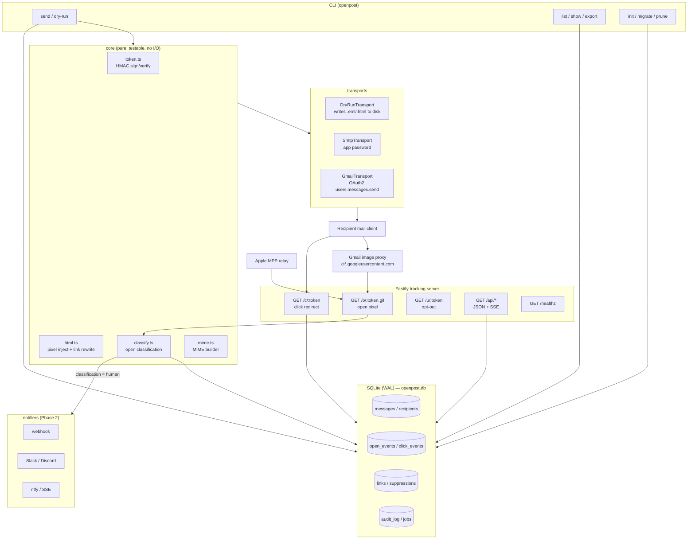

# 01 — Architecture

Project codename: **openpost** (self-hosted Gmail email open-tracking tool).
Goal: match or surpass Mailtrack (https://mailtrack.email/) in features, accuracy and usability,
while being fully self-hostable on a single Linux container with a single SQLite file.

---

## 1. Mailtrack feature analysis

| # | Mailtrack feature | How it works there | Our position |
|---|---|---|---|
| 1 | **1×1 pixel open tracking** | A tracking `` with a per-recipient URL is appended to outgoing HTML. A fetch of that URL = "open". Double-check-mark UI in Gmail. | Same mechanism, but with HMAC-signed opaque tokens and a classification engine (human / Google-proxy prefetch / Apple MPP / self-open). |
| 2 | **Real-time notifications** | Browser extension + push service notifies "X read your email". | Desktop-free: webhook / Slack / Discord / ntfy / SSE stream to the local dashboard. No browser extension required. |
| 3 | **Send log / dashboard** | Web dashboard listing every tracked email, per-recipient open state and timestamps. | Local dashboard (Phase 3) reading directly from SQLite + a CLI that renders the same data as tables/JSON. |
| 4 | **Link click tracking** (paid) | Outbound links rewritten through a redirector. | Phase 2, same approach, per (message, recipient, link) tokens, 302 redirect, original URL preserved byte-for-byte including query and fragment. |
| 5 | **Open count / device / approximate location** (paid) | Counts repeat fetches; parses User-Agent; IP → geo. | Same, but: raw IP is **never** stored (salted hash only), geo is coarse (country/region) and optional, device parsing is local (no third-party API). |
| 6 | **Reminders / follow-ups** (paid) | "Remind me if no reply in N days" scheduled server-side. | Phase 3: scheduler over SQLite, triggers on `no_open` / `no_reply` (reply detection via Gmail API thread polling). |
| 7 | **Mail merge / campaigns** (paid) | Bulk personalised sends. | Phase 4: CSV + template merge, per-recipient throttling, suppression list. |
| 8 | **Signature "Sent with Mailtrack"** | Free tier injects a promo signature. | Never. No branding injection, ever. |
| 9 | **Privacy posture** | Data sits on Mailtrack's servers; recipients cannot opt out. | Self-hosted, retention TTL, per-recipient opt-out link, `PRIVACY_MODE=strict` that stores nothing but a timestamp. |

**Where Mailtrack is weak and we win:** false positives from the Gmail image proxy and Apple Mail
Privacy Protection are reported as genuine opens; the sender's own view of the message in the Sent
folder can register as an open; data is not self-hosted; there is no scriptable API/CLI; there is no
audit trail. Our design attacks each of those explicitly (see `02_tracking_methods.md`).

---

## 2. Technology stack decision

**Chosen: Node.js 22 + TypeScript (strict).** One language for everything.

| Layer | Choice | Why |
|---|---|---|
| Language | **TypeScript on Node 22 LTS** | The tracking server, the CLI, the HTML rewriting and (Phase 3) the dashboard are all one codebase and one dependency tree. Email HTML manipulation (`cheerio`) and MIME building (`nodemailer`) are best-in-class in Node. `googleapis` is Google's own first-party Node SDK with built-in OAuth2 token refresh. Node ships a fast native `crypto` (HMAC), `fetch`, and a stable single-process event loop — exactly the shape of a pixel endpoint (thousands of tiny GET requests, no CPU work). Single-binary distribution via `node --experimental-sea-config` or `pkg`. Python would have been equally capable for the server, but would force a second toolchain for the dashboard and lose the `cheerio`/`nodemailer` ecosystem; a split Python-server + TS-frontend design doubles the build and test surface for zero benefit. **Decision: Node/TypeScript only. No Python in the runtime path.** |
| Web framework | **Fastify 5** | Lowest overhead per request of the mainstream Node frameworks, first-class TypeScript types, built-in schema validation, trivially embeddable (`buildServer()` returns an instance usable by `inject()` in tests without binding a port). Express is slower and its typing is bolted on; Hono is fine but Fastify's plugin/test story is stronger for a long-lived server. |
| DB | **SQLite via `better-sqlite3`** | Single file, zero daemon, synchronous API (no async ceremony in request handlers), WAL mode gives concurrent reads while the CLI writes. Matches the "single-process, single-binary" requirement. Easy to back up (`cp`) and to audit (`sqlite3` shell). |
| Migrations | **Plain numbered `.sql` files + `user_version`** | No ORM. The schema is small and read patterns are known; an ORM would add opacity and a build step. Queries live in one repository module. |
| Scheduler | **`node-cron` in-process + a `jobs` table** | Phase 3 reminders and Phase 1 retention pruning. In-process keeps "single binary" true; the `jobs` table makes runs crash-safe and idempotent. |
| HTML rewriting | **`cheerio`** | Server-side jQuery-like DOM over `htmlparser2`; preserves unknown tags/attributes, which matters for email HTML. |
| MIME / SMTP | **`nodemailer`** | Builds RFC-5322 `multipart/alternative` messages; doubles as the SMTP fallback transport; its `MailComposer` output is exactly what the Gmail API `users.messages.send` raw field needs. |
| Gmail | **`googleapis`** | Official, handles OAuth2 refresh, `gmail.send` + `gmail.readonly`. |
| CLI | **`commander` + `chalk`/`cli-table3`** | Familiar UX, subcommand help for free. |
| Tests | **`vitest`** | Fast, TS-native, `fastify.inject()` + in-memory SQLite (`:memory:`) means the whole unit+integration suite runs with **no Gmail credentials and no open port**. |
| Lint/format | **ESLint + Prettier** | Standard. |

---

## 3. Component diagram



---

## 4. Data model

SQLite, `PRAGMA journal_mode=WAL; PRAGMA foreign_keys=ON;`. All timestamps are **integer Unix
milliseconds UTC**. All ids are 16-byte random, base32-crockford encoded (26 chars, URL-safe, sortable
prefix not required).

```sql
-- 001_init.sql  (schema_version = 1)

CREATE TABLE accounts (
  id            TEXT PRIMARY KEY,
  email         TEXT NOT NULL UNIQUE,      -- sending identity
  display_name  TEXT,
  transport     TEXT NOT NULL,             -- 'gmail' | 'smtp' | 'dryrun'
  created_at    INTEGER NOT NULL
);

CREATE TABLE messages (
  id            TEXT PRIMARY KEY,
  account_id    TEXT NOT NULL REFERENCES accounts(id) ON DELETE CASCADE,
  subject       TEXT NOT NULL,
  body_html     TEXT,                      -- stored pre-personalisation (template)
  body_text     TEXT,
  thread_id     TEXT,                      -- Gmail thread id, when known
  provider_msg_id TEXT,                    -- Gmail message id
  rfc822_msg_id TEXT,                      -- Message-ID header
  status        TEXT NOT NULL,             -- 'draft'|'sent'|'failed'|'dryrun'
  tracking_enabled     INTEGER NOT NULL DEFAULT 1,
  click_tracking_enabled INTEGER NOT NULL DEFAULT 0,
  sent_at       INTEGER,
  created_at    INTEGER NOT NULL,
  error         TEXT
);
CREATE INDEX idx_messages_account_sent ON messages(account_id, sent_at DESC);

CREATE TABLE recipients (
  id            TEXT PRIMARY KEY,
  message_id    TEXT NOT NULL REFERENCES messages(id) ON DELETE CASCADE,
  email         TEXT NOT NULL,
  name          TEXT,
  kind          TEXT NOT NULL DEFAULT 'to', -- 'to'|'cc'|'bcc'
  token         TEXT NOT NULL UNIQUE,       -- the opaque tracking token (see 02)
  open_count    INTEGER NOT NULL DEFAULT 0, -- human-classified opens only
  machine_open_count INTEGER NOT NULL DEFAULT 0,
  first_open_at INTEGER,
  last_open_at  INTEGER,
  click_count   INTEGER NOT NULL DEFAULT 0,
  first_click_at INTEGER,
  replied_at    INTEGER,                    -- Phase 3, via gmail.readonly
  opted_out_at  INTEGER,
  created_at    INTEGER NOT NULL
);
CREATE INDEX idx_recipients_message ON recipients(message_id);
CREATE INDEX idx_recipients_email ON recipients(email);

CREATE TABLE open_events (
  id            TEXT PRIMARY KEY,
  recipient_id  TEXT NOT NULL REFERENCES recipients(id) ON DELETE CASCADE,
  occurred_at   INTEGER NOT NULL,
  classification TEXT NOT NULL,   -- 'human'|'google_proxy_prefetch'|'apple_mpp'|'self_open'
                                  -- |'bot'|'duplicate'|'unknown'
  confidence    REAL NOT NULL,    -- 0.0..1.0
  counted       INTEGER NOT NULL, -- 1 => incremented recipients.open_count
  reason        TEXT,             -- machine-readable rule id(s), comma separated
  ip_hash       TEXT,             -- HMAC(ip, daily salt), truncated; NULL in strict privacy mode
  ip_net_hash   TEXT,             -- HMAC of /24 (v4) or /48 (v6), for repeat-device grouping
  ua            TEXT,             -- raw UA; NULL in strict privacy mode
  ua_family     TEXT,             -- 'GoogleImageProxy'|'AppleMail'|'Outlook'|'Chrome'|...
  device_type   TEXT,             -- 'desktop'|'mobile'|'tablet'|'proxy'|'unknown'
  os            TEXT,
  country       TEXT,             -- ISO-3166 alpha-2, optional
  region        TEXT,
  city          TEXT,             -- only when PRIVACY_MODE=off and a local geo DB is present
  created_at    INTEGER NOT NULL
);
CREATE INDEX idx_open_events_recipient_time ON open_events(recipient_id, occurred_at DESC);
CREATE INDEX idx_open_events_time ON open_events(occurred_at DESC);

CREATE TABLE links (
  id            TEXT PRIMARY KEY,
  message_id    TEXT NOT NULL REFERENCES messages(id) ON DELETE CASCADE,
  url           TEXT NOT NULL,
  label         TEXT,                       -- anchor text, truncated
  position      INTEGER NOT NULL,           -- order of appearance in the HTML
  created_at    INTEGER NOT NULL
);
CREATE INDEX idx_links_message ON links(message_id);

CREATE TABLE click_events (
  id            TEXT PRIMARY KEY,
  link_id       TEXT NOT NULL REFERENCES links(id) ON DELETE CASCADE,
  recipient_id  TEXT NOT NULL REFERENCES recipients(id) ON DELETE CASCADE,
  occurred_at   INTEGER NOT NULL,
  classification TEXT NOT NULL,             -- 'human'|'scanner'|'duplicate'
  counted       INTEGER NOT NULL,
  ip_hash       TEXT, ip_net_hash TEXT, ua TEXT, ua_family TEXT,
  device_type   TEXT, os TEXT, country TEXT,
  created_at    INTEGER NOT NULL
);
CREATE INDEX idx_click_events_recipient ON click_events(recipient_id, occurred_at DESC);

CREATE TABLE suppressions (             -- opt-out / do-not-track list
  email         TEXT PRIMARY KEY,
  reason        TEXT NOT NULL,          -- 'recipient_optout'|'manual'|'bounce'
  created_at    INTEGER NOT NULL
);

CREATE TABLE notifications (            -- Phase 2 delivery log
  id            TEXT PRIMARY KEY,
  event_type    TEXT NOT NULL,          -- 'open'|'click'|'reminder'
  event_id      TEXT NOT NULL,
  channel       TEXT NOT NULL,          -- 'webhook'|'slack'|'discord'|'ntfy'|'sse'
  status        TEXT NOT NULL,          -- 'pending'|'sent'|'failed'
  attempts      INTEGER NOT NULL DEFAULT 0,
  last_error    TEXT,
  created_at    INTEGER NOT NULL,
  sent_at       INTEGER
);

CREATE TABLE reminders (                -- Phase 3
  id            TEXT PRIMARY KEY,
  message_id    TEXT NOT NULL REFERENCES messages(id) ON DELETE CASCADE,
  recipient_id  TEXT REFERENCES recipients(id) ON DELETE CASCADE,
  condition     TEXT NOT NULL,          -- 'no_open'|'no_click'|'no_reply'
  due_at        INTEGER NOT NULL,
  state         TEXT NOT NULL,          -- 'pending'|'fired'|'cancelled'
  fired_at      INTEGER,
  created_at    INTEGER NOT NULL
);
CREATE INDEX idx_reminders_due ON reminders(state, due_at);

CREATE TABLE jobs (                     -- crash-safe scheduler bookkeeping
  name          TEXT PRIMARY KEY,       -- 'prune'|'reminders'|'reply_sync'
  last_run_at   INTEGER,
  last_status   TEXT,
  last_error    TEXT
);

CREATE TABLE audit_log (                -- append-only; never UPDATEd or DELETEd by app code
  id            TEXT PRIMARY KEY,
  at            INTEGER NOT NULL,
  actor         TEXT NOT NULL,          -- 'cli'|'server'|'scheduler'
  action        TEXT NOT NULL,          -- 'message.send'|'open.record'|'token.reject'|...
  subject_type  TEXT, subject_id TEXT,
  detail_json   TEXT
);
CREATE INDEX idx_audit_at ON audit_log(at DESC);

CREATE TABLE settings (                 -- key/value: secret fingerprint, salts, schema notes
  key           TEXT PRIMARY KEY,
  value         TEXT NOT NULL,
  updated_at    INTEGER NOT NULL
);
```

Derived views (`v_message_stats`, `v_recipient_stats`) are added in Phase 2 for the dashboard;
Phase 1 computes aggregates with plain queries.

---

## 5. API endpoints

### Public (must be reachable by mail clients)

| Method | Path | Purpose | Response |
|---|---|---|---|
| GET | `/o/:token.gif` | Open pixel. Verifies HMAC, records an `open_event`, classifies it. | `200 image/gif`, 43-byte transparent GIF, `Cache-Control: no-store, no-cache, must-revalidate, max-age=0`, `Pragma: no-cache`, `Expires: 0`. **Always 200**, even for invalid tokens (never leak validity). |
| HEAD | `/o/:token.gif` | Same headers, no body, no event recorded (HEAD is a scanner signature). | `200` |
| GET | `/c/:token` | Click redirect. Records a `click_event`, then redirects. | `302` + `Location: <original url>`, `Referrer-Policy: no-referrer`, `Cache-Control: no-store`. Invalid token → `302` to `TRACKING_FALLBACK_URL` or `404` if unset. |
| GET | `/u/:token` | Recipient opt-out. Adds to `suppressions`, marks recipient `opted_out_at`. | `200 text/html` confirmation page. |
| GET | `/healthz` | Liveness + schema version. | `200 application/json` `{"ok":true,"version":"...","schema":1,"db":"ok"}` |

### Local API (bound to `127.0.0.1` by default, `Authorization: Bearer $API_TOKEN` when exposed)

| Method | Path | Purpose |
|---|---|---|
| GET | `/api/messages?limit&offset&status` | Message list with aggregate open/click counts |
| GET | `/api/messages/:id` | Message + recipients + events |
| GET | `/api/recipients/:id/events` | Full event timeline for one recipient |
| GET | `/api/events/stream` | SSE stream of newly classified events (dashboard/notifier, Phase 2) |
| GET | `/api/stats?since` | Aggregates: sends, unique opens, open rate, click rate |
| POST | `/api/messages/:id/recipients/:rid/reclassify` | Manual override of a misclassified event (Phase 2) |
| DELETE | `/api/messages/:id` | Delete a message and cascade its events (GDPR-style erase) |

Phase 3 adds `/dashboard/*` (server-rendered) using the same handlers.

---

## 6. Directory layout

```
gmail_read/
├── docs/                         # these design documents
│   ├── 01_architecture.md
│   ├── 02_tracking_methods.md
│   ├── 03_roadmap.md
│   └── 04_phase1_spec.md
├── src/
│   ├── cli/
│   │   ├── index.ts              # commander entrypoint (bin: openpost)
│   │   └── commands/
│   │       ├── init.ts  migrate.ts  send.ts  serve.ts
│   │       ├── list.ts  show.ts     export.ts  prune.ts
│   ├── config/
│   │   └── env.ts                # loadConfig(): AppConfig  (dotenv + validation)
│   ├── core/
│   │   ├── ids.ts                # newId(), base32 encode
│   │   ├── token.ts              # signToken / verifyToken (HMAC-SHA256)
│   │   ├── html.ts               # injectPixel, rewriteLinks, htmlToText
│   │   ├── classify.ts           # classifyOpen / classifyClick
│   │   ├── ua.ts                 # parseUserAgent -> {family, deviceType, os}
│   │   ├── privacy.ts            # hashIp, dailySalt, redactForMode
│   │   └── time.ts               # now(), Clock interface (injectable for tests)
│   ├── db/
│   │   ├── index.ts              # openDb, migrate, withTx
│   │   ├── repo.ts               # all SQL (typed repository functions)
│   │   └── migrations/001_init.sql
│   ├── mail/
│   │   ├── mime.ts               # buildMime()
│   │   ├── transport.ts          # Transport interface + resolveTransport()
│   │   ├── dryrun.ts  smtp.ts  gmail.ts
│   │   └── oauth.ts              # Phase 1.5: OAuth2 device/loopback flow
│   ├── server/
│   │   ├── app.ts                # buildServer(deps): FastifyInstance
│   │   ├── assets.ts             # TRANSPARENT_GIF
│   │   └── routes/
│   │       ├── pixel.ts  click.ts  optout.ts  health.ts  api.ts
│   ├── notify/                   # Phase 2
│   └── types.ts
├── tests/
│   ├── unit/                     # token, html, classify, ua, privacy, mime
│   ├── integration/              # fastify.inject() + :memory: sqlite; send→open→count
│   └── fixtures/                 # sample HTML bodies, UA strings, proxy requests
├── scripts/
│   └── curl-smoke.sh             # manual verification steps from 04
├── .env.example
├── package.json  tsconfig.json  vitest.config.ts  eslint.config.js
└── README.md
```

Runtime data lives outside `src/`: `data/openpost.db` (configurable via `DB_PATH`) and
`out/` for dry-run artefacts.

---

## 7. Addendum — click token table

`click_events` references `(link_id, recipient_id)`, but a click URL must carry a single opaque
`rid`. The binding table (created in migration 001 so Phase 2 needs no schema change):

```sql
CREATE TABLE click_tokens (
  id            TEXT PRIMARY KEY,          -- the `rid` signed into the /c/<token> URL
  link_id       TEXT NOT NULL REFERENCES links(id) ON DELETE CASCADE,
  recipient_id  TEXT NOT NULL REFERENCES recipients(id) ON DELETE CASCADE,
  created_at    INTEGER NOT NULL,
  UNIQUE(link_id, recipient_id)
);
CREATE INDEX idx_click_tokens_recipient ON click_tokens(recipient_id);
```

The open token's `rid` is `recipients.token`; the opt-out token's `rid` is also `recipients.token`
(purpose separation in the HMAC keeps the two URLs non-interchangeable).
